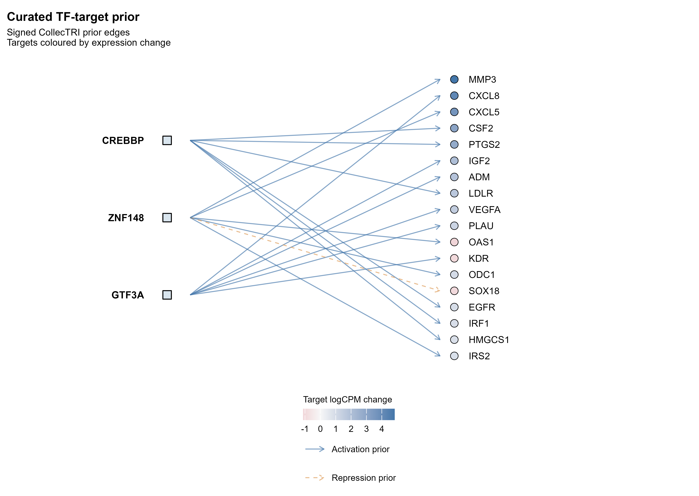
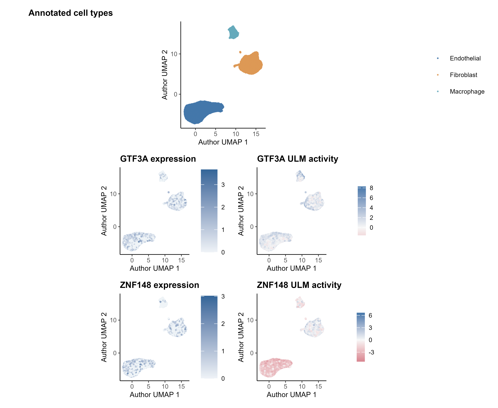

# collectri Figure Gallery

状态 / Status：`implemented` 仅指本仓库已有真实运行和图件；`planned` 表示尚未完成该图。软件支持与本仓库执行分开记录。

## collectri-01 · Signed prior TF–target network

- 科学用途 / Purpose：显示用于打分的有符号文献先验
- 所需数据 / Input：CollecTRI version/source；matched edges；weights/signs
- 生成方式 / Generation：资源本身不生成活性图；scripts/plot_atlas.R 定制 prior 网络
- 代码入口 / Entry：[R 入口](../scripts/plot_atlas.R)；源结果、筛选和版本见 [provenance](../results/figures/figure_provenance.json)
- 示例 / Example：；[图注与真实结果说明](real_figures.md)
- 解读 / Interpretation：实线与虚线等编码区分激活和抑制先验
- 场景 / Scenario：解释真实活性候选 TF 的 prior targets
- 局限与误用 / Limits：这里是预构建先验，不是本队列 de novo 推断边
- 状态 / Status：`implemented`

## collectri-02 · CollecTRI ULM activity landscape

- 科学用途 / Purpose：利用带符号靶基因足迹估计 TF 活性
- 所需数据 / Input：表达矩阵；过滤后 CollecTRI；ULM outputs
- 生成方式 / Generation：decoupler 实际评分后 scripts/plot_atlas.R
- 代码入口 / Entry：[R 入口](../scripts/plot_atlas.R)；源结果、筛选和版本见 [provenance](../results/figures/figure_provenance.json)
- 示例 / Example：；[图注与真实结果说明](real_figures.md)
- 解读 / Interpretation：目标的方向性表达足迹支持推断活性
- 场景 / Scenario：RNA-only 单细胞/供体 pseudobulk
- 局限与误用 / Limits：不证明 TF binding；依赖目标覆盖与跨组织可迁移性
- 状态 / Status：`implemented`

## collectri-03 · Complex handling sensitivity

- 科学用途 / Purpose：检查复合体拆分对 TF 结果的影响
- 所需数据 / Input：同输入、split_complexes 设置的实际重跑结果
- 生成方式 / Generation：定制 TF rank/effect 配对图
- 代码入口 / Entry：[官方文档或源码](https://decoupler.readthedocs.io/)；定制图在对应输出真实完成后加入
- 示例 / Example：待实现；未生成示例图片
- 解读 / Interpretation：差异仅归因于同一资源处理选择
- 场景 / Scenario：AP-1/NF-κB 等复合体候选优先级评估
- 局限与误用 / Limits：不得将复合体分数误认为每个亚基独立活性
- 状态 / Status：`planned`
