# 本次真实图件 / Executed figure gallery

本次输出 13 套真实图件（每套 PDF、SVG、600 dpi PNG），包含一张 8 面板综合图。全部由 [R 源代码](../scripts/plot_atlas.R) 生成；样式、筛选规则和边界见 [图件契约](../config/figure_contract.json)，输入表校验值、显示子集和软件版本见 [图件 provenance](../results/figures/figure_provenance.json)。PDF/SVG 的文字保留为可编辑文字；密集 UMAP 点使用 R 原生栅格化以控制文件大小。

## 数据与统计共同说明 / Shared data and statistics

使用 CELLxGENE 公共牙周组织数据中 Williams/GSE164241 的同研究 Healthy/Periodontitis 子集。原对象 105,918 个细胞，本分析保留 38,971 个作者注释的成纤维细胞、内皮细胞和巨噬细胞；全部输入绘图细胞均被保留，没有为排版抽样或改变作者 UMAP。细胞表达为 `log1p(counts / library_size * 10000)`；正式活性比较使用 donor × cell type pseudobulk，基因表达为 `log2(CPM + 1)`，在每个 cell type 内按基因中心化后评分。分析基因 universe 为 21,690，516 个先验调控因子满足至少 10 个匹配 target。

每个 donor × cell type 至少 50 个细胞。成纤维细胞和内皮细胞分别有 13 Healthy、5 Periodontitis 的供体分组；巨噬细胞为 6 Healthy、4 Periodontitis。疾病样本后缀保守合并为供体分组，其独立生物学身份仍存在来源核查限制。模型使用 `disease + assay`，效应是 assay 校正后的疾病系数，HC3 95% CI 与 t-based p 值按供体单位计算，BH 校正在 cell type × method 内进行。疾病与 assay 不平衡、疾病供体较少以及供体映射的不确定性使结果保持探索性；它们不支持临床预测或因果结论。

CollecTRI 含序列特异 TF 和部分共调控因子，CREBBP、NFKBIB 等不能一概称为序列特异 TF。细胞 ULM 分数使用固定的全局分析基因 universe；target matching 不等于每个细胞都检测到相同 targets。共表达模块、ARACNe de novo 网络、motif pruning、RSS 和扰动模拟均未在本次案例中完成，相关类型仍在 [长期目录](README.md) 中标为待实现。

## Composite · Transcriptional regulatory landscape of periodontal inflammation

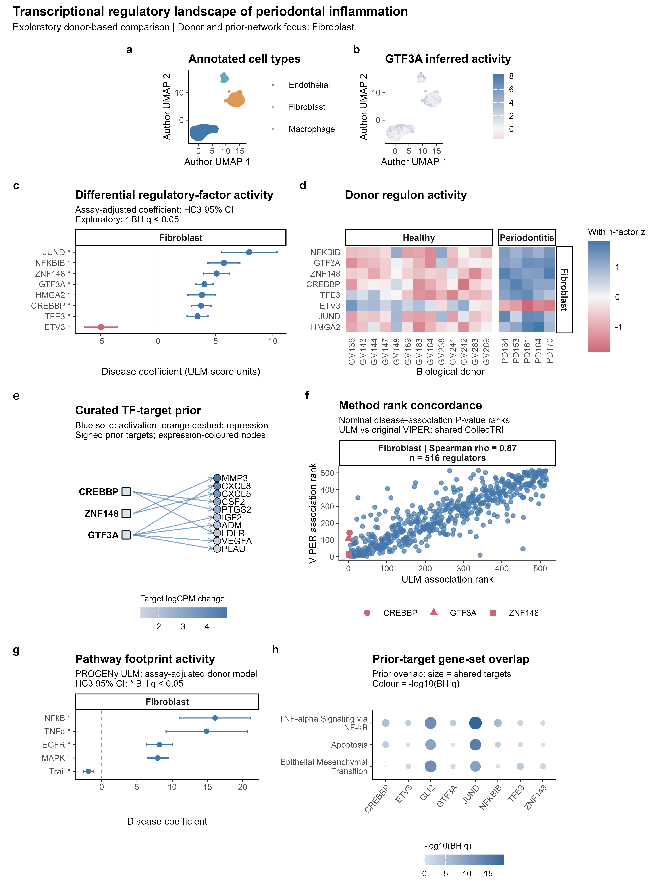

**English legend.** a, Author-provided UMAP of all 38,971 analyzed cells. b, GTF3A ULM activity on the same coordinates. c, Eight fibroblast regulatory factors selected by donor-level BH q, with assay-adjusted disease coefficients and HC3 95% confidence intervals; an asterisk denotes BH q < 0.05. d, Corresponding donor activities, standardized within each factor; columns are the 13 healthy and 5 periodontitis donor groups. e, Three result-selected regulators and their ten displayed CollecTRI targets ranked by absolute descriptive target-expression change; arrowheads denote curated prior direction, and target-node colour denotes disease-minus-healthy fibroblast logCPM change. f, Nominal disease-association P-value ranks for ULM and original Bioconductor VIPER across 516 shared regulators; Spearman rho refers to these ranks. Shapes highlight three candidates. g, Five fibroblast PROGENy pathways selected by BH q, with the same donor model and interval definition. h, CollecTRI target overlaps with the three Hallmark sets having the smallest observed minimum BH q; size denotes the number of shared targets and colour denotes -log10(BH q). Panels e and h represent prior evidence, not sample-specific de novo edges or measured pathway activation. All donor effects remain exploratory.

**中文解释。** 综合图以成纤维细胞为供体比较和先验网络的重点，连接细胞背景、调控足迹、供体效应、方法一致性及通路证据。c/d 是推断活性和模型比较，e/h 是先验结构与基因集重叠，g 是另一套真实计算的通路足迹；各类证据不能相互替代。此图没有把基因集重叠称为共表达模块。

[PDF](../results/figures/Composite_periodontal_regulatory_landscape.pdf) · [SVG](../results/figures/Composite_periodontal_regulatory_landscape.svg)。输入：`cells.csv.gz`、`differential_activity.csv`、`pseudobulk_activity.csv`、`selected_network_edges.csv`、`method_concordance.csv`、`progeny_differential.csv`、`tf_pathway_links.csv`。

## Fig01 · Executed regulatory-activity workflow

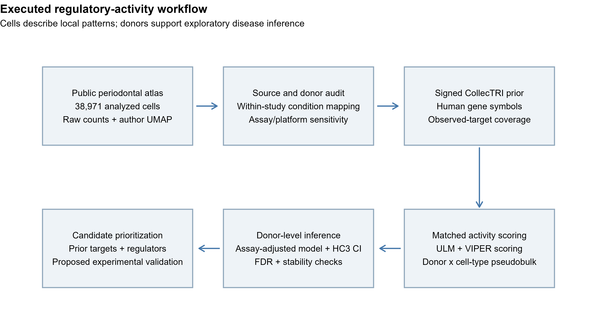

**English legend.** The executed workflow links audited public counts and author annotations, study/donor mapping, signed CollecTRI target coverage, matched ULM and VIPER scoring, donor-level assay-adjusted inference and sensitivity checks, and candidate prioritization. Experimental validation is proposed and was not performed in this repository. The diagram reports the actual analyzed cell count and distinguishes cell-level descriptive observations from donor-level inference.

**中文解释。** 流程图记录本次真实执行的 RNA/先验活性路线。末端是候选优先级与后续实验建议，没有把 ARACNe、SCENIC、染色质分析或实验验证画成已完成步骤。

[PDF](../results/figures/Fig01_analysis_workflow.pdf) · [SVG](../results/figures/Fig01_analysis_workflow.svg)。输入：真实结果表、供体元数据与运行参数。

## Fig02 · TF expression and activity on the author UMAP

**English legend.** Author-provided UMAP coordinates are shown for all analyzed cells, coloured by annotated cell type, normalized GTF3A/ZNF148 expression, or CollecTRI ULM activity. The two factors were selected from actual donor-level results and available expression/activity columns. Expression and activity use separate numerical scales. No new embedding, lineage trajectory, or causal state transition was inferred; dense points were rasterized at 600 dpi without cell sampling.

**中文解释。** 同一组细胞坐标并排展示 TF 自身表达与下游 target 足迹，避免把两者等同。颜色差异是描述性分布，不能把 UMAP 的局部距离当作谱系或调控方向。

[PDF](../results/figures/Fig02_tf_activity_umap.pdf) · [SVG](../results/figures/Fig02_tf_activity_umap.svg)。输入：[cells.csv.gz](../results/tables/cells.csv.gz)、[differential_activity.csv](../results/tables/differential_activity.csv)。

## Fig03 · Donor regulon activity

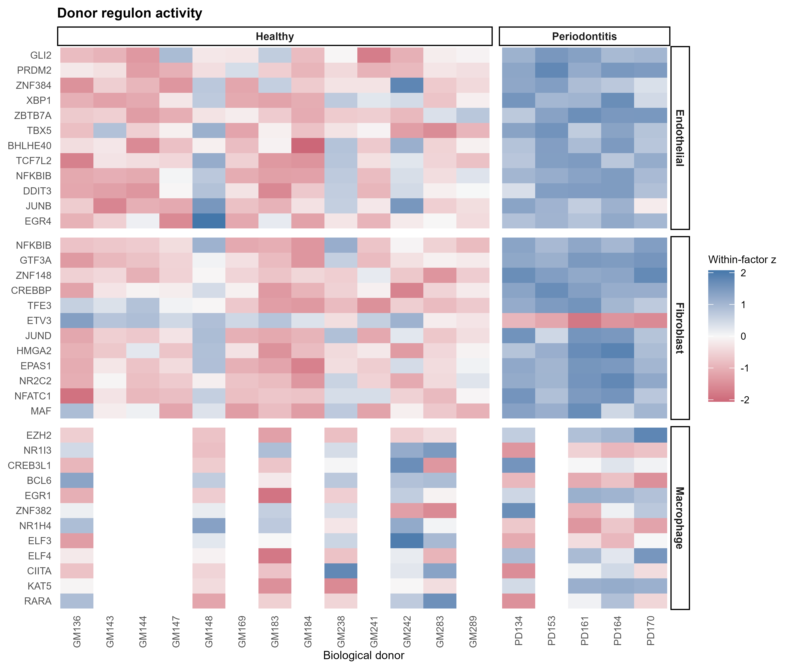

**English legend.** ULM activities of the twelve displayed regulatory factors per cell type are shown for donor pseudobulk samples. Factors were selected by donor-level BH q and absolute effect. Values are z-scores within each factor and cell type across the available donors; constant rows map to zero. White donor columns in macrophages indicate combinations absent after the prespecified cell-count threshold, not zero activity. No inferential uncertainty is encoded in this descriptive heatmap; model intervals are shown separately in Fig05.

**中文解释。** 热图能观察疾病组和供体内的表达足迹模式，但同一行的蓝色与另一行的蓝色不能比较绝对强度。巨噬细胞只有 6+4 个合格供体组合，空白列不应补零。

[PDF](../results/figures/Fig03_donor_activity_heatmap.pdf) · [SVG](../results/figures/Fig03_donor_activity_heatmap.svg)。输入：[pseudobulk_activity.csv](../results/tables/pseudobulk_activity.csv)、[differential_activity.csv](../results/tables/differential_activity.csv)。

## Fig04 · Curated TF-target prior

**English legend.** Displayed edges are matched CollecTRI curated-prior relations for three result-selected regulators, with targets ranked by absolute supplied fibroblast expression contrast. Solid blue and dashed orange edges encode positive and negative prior weights. Arrowheads indicate curated regulator-target roles. Target colour denotes descriptive disease-minus-healthy donor logCPM expression change. Some resource signs originate from a default activation decision and should not be interpreted as direct experimental sign evidence. No ARACNe mutual-information edges, motif-pruned edges or sample-specific causal links were inferred for this graph.

**中文解释。** 该图解释候选调控因子打分所依据的真实先验 targets。目标基因的表达变化来自本队列，连边和符号来自数据库；表达变化不能证明这条先验边在牙周炎中实际发生。

[PDF](../results/figures/Fig04_curated_tf_target_network.pdf) · [SVG](../results/figures/Fig04_curated_tf_target_network.svg)。输入：[selected_network_edges.csv](../results/tables/selected_network_edges.csv)，包含 `references`、`evidence_type`、`sign_decision` 与 contrast context。

## Fig05 · Differential regulatory-factor activity

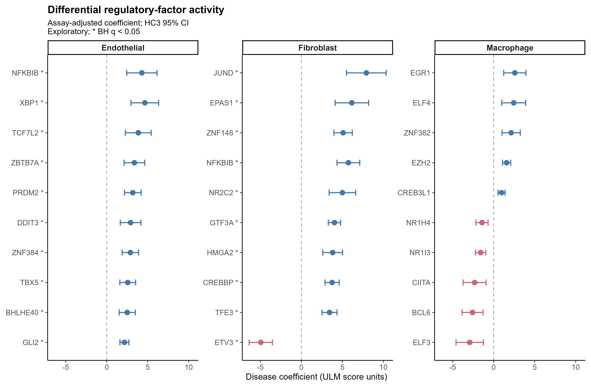

**English legend.** Ten regulatory factors per cell type, selected by smallest BH q and then largest absolute effect, are shown with assay-adjusted disease coefficients and HC3 95% confidence intervals. Blue and rose indicate positive and negative coefficients. An asterisk denotes BH q < 0.05 after correction within cell type and method. Donor numbers are 13 healthy/5 periodontitis for fibroblasts and endothelial cells and 6/4 for macrophages. Model coefficients describe activity-score differences, not measured protein activation or causal effects; assay imbalance and uncertain donor mapping limit inference.

**中文解释。** 优先看效应方向、区间、供体数和敏感性结果，再看 q 值。成纤维细胞和内皮细胞的候选不应直接推断为巨噬细胞同样存在的程序；CREBBP、NFKBIB 等包含共调控因子。

[PDF](../results/figures/Fig05_differential_tf_activity.pdf) · [SVG](../results/figures/Fig05_differential_tf_activity.svg)。输入：[differential_activity.csv](../results/tables/differential_activity.csv)。

## Fig09 · Cell-type regulatory activity profile

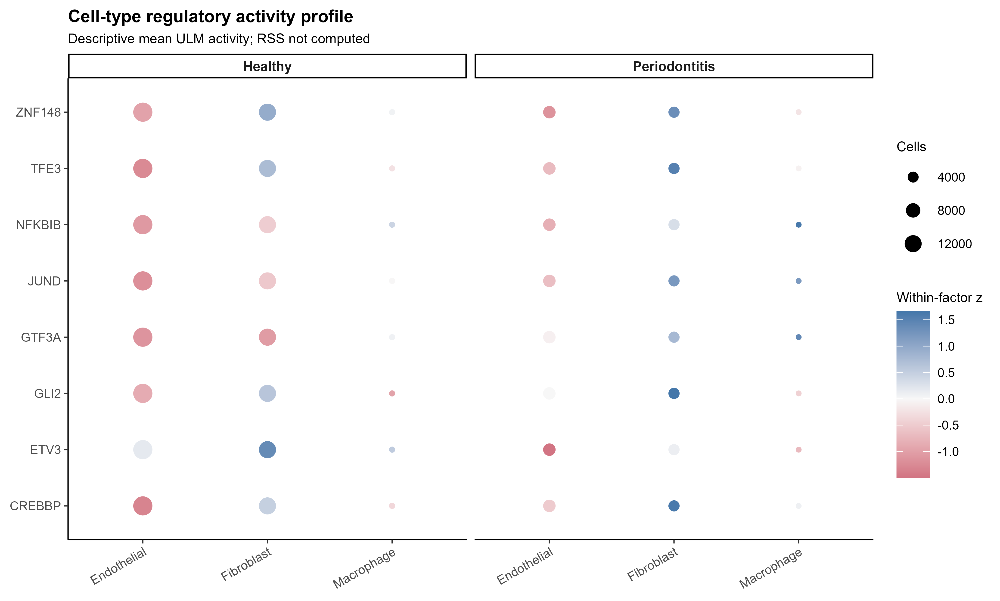

**English legend.** Cell-type/condition mean ULM activities of the available selected factors are standardized within factor for descriptive display. Point area denotes the number of analyzed cells, not the fraction of positive cells or biological replicate number. This DotPlot is a cell-type activity profile; a Regulon Specificity Score was not calculated. Cell means do not replace donor-level tests.

**中文解释。** 图示细胞类型和疾病分组的均值模式，点大仅表示细胞多。这里没有使用 AUCell，也没有把有正负值的 ULM 分数错误称作 RSS。

[PDF](../results/figures/Fig09_celltype_activity_profile.pdf) · [SVG](../results/figures/Fig09_celltype_activity_profile.svg)。输入：[celltype_activity.csv](../results/tables/celltype_activity.csv)。

## Fig12 · Method association-rank concordance

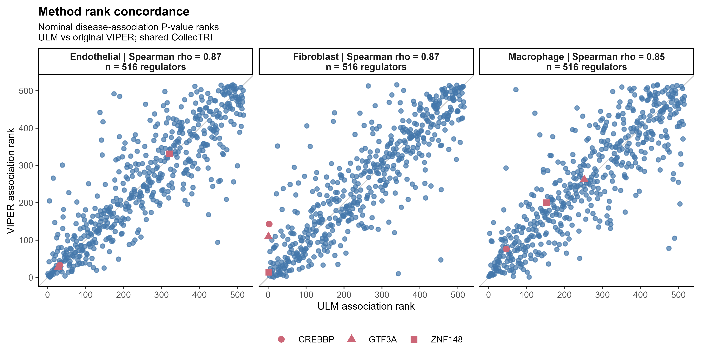

**English legend.** Nominal donor-level disease-association P-value ranks from ULM and original Bioconductor VIPER 1.36.0 are compared for 516 shared regulators within each cell type. Lower ranks indicate smaller nominal P values. Spearman rho is computed across these ranks; it is distinct from the correlation of disease-effect magnitudes. Both methods use the same centered pseudobulk expression and matched CollecTRI prior. Shapes highlight three result-selected regulators. Shared-prior agreement is an algorithm comparison, not independent biological validation; rankings do not guarantee effect-direction agreement.

**中文解释。** 该图比较两种真实运行的评分算法对疾病关联的排序。坐标不是效应量排名，也不是两个独立队列的验证；效应方向和效应大小应查看完整结果表及验证报告。

[PDF](../results/figures/Fig12_method_concordance.pdf) · [SVG](../results/figures/Fig12_method_concordance.svg)。输入：[method_concordance.csv](../results/tables/method_concordance.csv)；Python decoupler VIPER 的额外字段保留供实现比较，当前图使用原始 Bioconductor VIPER。

## Fig13 · Donor pathway activity

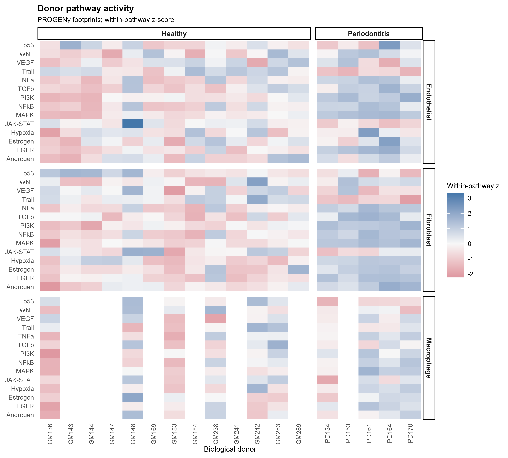

**English legend.** Actual PROGENy ULM footprint scores for fourteen pathways are shown for donor pseudobulk samples, z-scored within pathway and cell type. These are pathway activities inferred from weighted expression footprints, not TF/regulon activities. Blank donor columns indicate absent combinations after cell-count filtering. The heatmap is descriptive and complements the donor-model effects in Fig13b.

**中文解释。** PROGENy 使用加权信号响应足迹估计通路活动，不能将 NFkB 这个通路名称等同于某一个 NF-κB 亚基的 TF 活性，也不能将颜色直接解释为蛋白磷酸化水平。

[PDF](../results/figures/Fig13_progeny_donor_pathways.pdf) · [SVG](../results/figures/Fig13_progeny_donor_pathways.svg)。输入：[progeny_activity_matrix.csv](../results/tables/progeny_activity_matrix.csv)、[pseudobulk_metadata.csv](../results/tables/pseudobulk_metadata.csv)。

## Fig13b · Differential pathway footprint activity

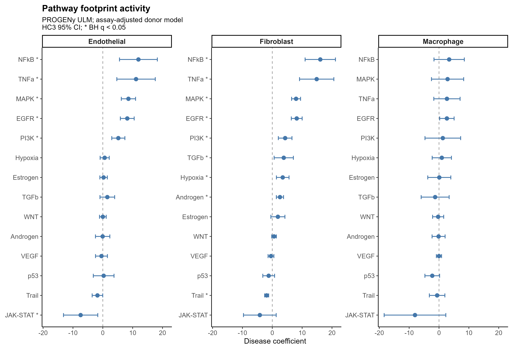

**English legend.** Assay-adjusted disease coefficients for all fourteen PROGENy pathways are shown with HC3 95% confidence intervals. An asterisk denotes BH q < 0.05 within cell type and method. Donor numbers and mapping limitations are the same as Fig05. These results describe pathway-footprint associations and do not establish upstream signaling causality.

**中文解释。** 可以由此筛查炎症信号候选；仍需结合 donor 敏感性结果和独立蛋白/信号验证。该图的统计单位是供体组合，未将细胞数作为独立样本量。

[PDF](../results/figures/Fig13b_progeny_disease_effects.pdf) · [SVG](../results/figures/Fig13b_progeny_disease_effects.svg)。输入：[progeny_differential.csv](../results/tables/progeny_differential.csv)。

## Fig14 · Original VIPER donor activity

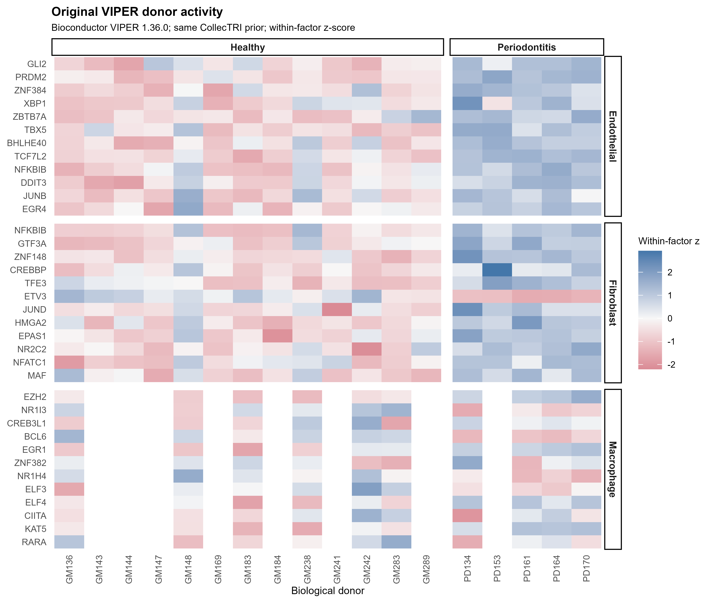

**English legend.** Original Bioconductor VIPER 1.36.0 NES activities are shown for the same twelve selected factors per cell type as Fig03. Inputs are the same centered donor pseudobulk matrix and matched signed CollecTRI targets, with uniform target likelihood, minsize 10 and pleiotropy correction enabled. Values are standardized within factor and cell type for display, with the same factor ordering as Fig03. No de novo ARACNe reconstruction or msVIPER master-regulator analysis was performed.

**中文解释。** 此图来自真正执行的原始 R VIPER，区别于 Python reimplementation；它与 ULM 的数值量纲不应直接相减。网络使用已有可核查先验，未声称建立新的牙周炎 ARACNe 网络。

[PDF](../results/figures/Fig14_original_viper_activity.pdf) · [SVG](../results/figures/Fig14_original_viper_activity.svg)。输入：[bioc_viper_activity_matrix.csv](../results/tables/bioc_viper_activity_matrix.csv)；入口：[run_viper.R](../methods/viper/run_viper.R)；运行证据：[R_runtime.json](../methods/viper/R_runtime.json)。

## Fig15 · Prior-target gene-set overlap

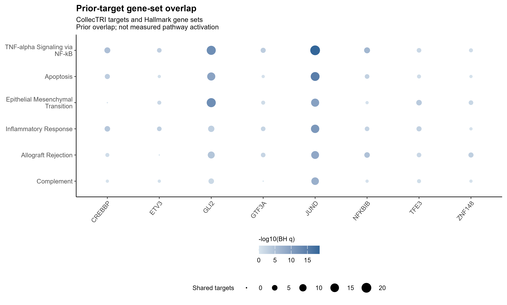

**English legend.** Eight selected regulators are compared with the six Hallmark gene sets having the smallest observed minimum BH q across regulators. Point area denotes the number of matched CollecTRI targets shared with a gene set; colour denotes -log10(BH q) from the supplied hypergeometric overlap analysis. The expressed gene universe is 21,690. All eight regulator pairs for each displayed set are retained, including zero-overlap pairs represented by zero point area. The complete table contains all 400 tested regulator/set pairs. These are curated-prior gene-set associations, not inferred coexpression modules, disease-specific enrichment of differentially expressed genes or measured pathway activation.

**中文解释。** 它回答“先验 target 与哪些基因集重叠”，用于解释候选程序；不回答“该 TF 在疾病中驱动了这个通路”。图中没有虚构 TF–module 连边，也没有把 Hallmark gene set 当作 hdWGCNA module。

[PDF](../results/figures/Fig15_tf_hallmark_overlap.pdf) · [SVG](../results/figures/Fig15_tf_hallmark_overlap.svg)。输入：[tf_pathway_links.csv](../results/tables/tf_pathway_links.csv)。

## Fig16 · Regulator expression and inferred activity

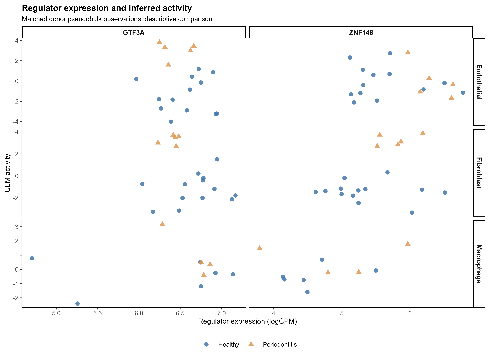

**English legend.** Each point is a matched donor × cell-type pseudobulk observation for GTF3A or ZNF148, plotting the regulator's own log2(CPM + 1) expression against its downstream CollecTRI ULM activity. Colours and shapes identify healthy and periodontitis groups. This is a descriptive paired-variable display without a fitted causal model, significance annotation or regression line. Expression–activity agreement or discordance alone does not identify a transcriptional or post-transcriptional mechanism.

**中文解释。** 可以看到 TF 自身表达与 target 足迹是否共同变化，供体分组用颜色和形状双重编码。单个散点和总体相关不能证明 TF 蛋白活性或转录后调控机制。

[PDF](../results/figures/Fig16_donor_expression_activity.pdf) · [SVG](../results/figures/Fig16_donor_expression_activity.svg)。输入：[donor_expression_activity.csv](../results/tables/donor_expression_activity.csv)。

## 重新生成 / Reproduce

在仓库根目录，先按环境说明配置独立 R 包库，然后运行 `Rscript scripts/plot_atlas.R`。脚本只读取已存在的真实结果表；缺表、缺列、缺实际评分或非有限 UMAP/关键分数会直接报错。不会生成模拟数据作为替代。原始 VIPER 入口是 `Rscript methods/viper/run_viper.R`，读取真实中心化 pseudobulk 和 CollecTRI prior。参数及随机种子来自 `config/analysis.json`，所有图件只由 R 绘制。

图中缺少的 Fig06/07/08/10/11 保持 `planned`，理由分别是没有实际 hdWGCNA 模块、模块与通路组合关系、真实多模块联系、扰动模拟或染色质/motif 证据。后续新方法应先完成真实分析、检验输入和独立图，再更新 Gallery 状态。
